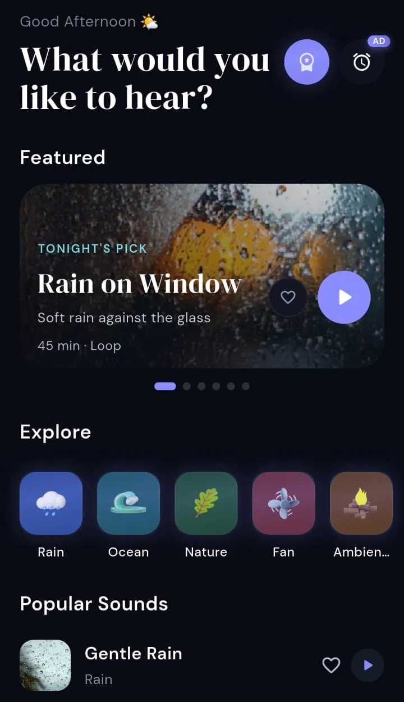
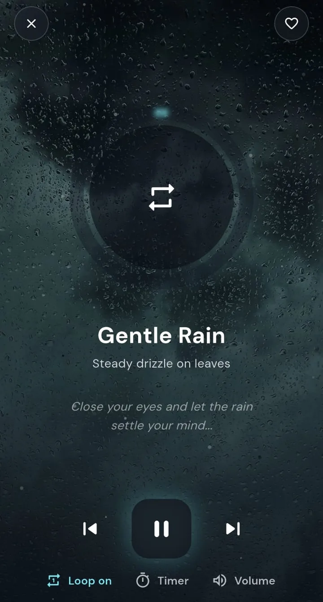
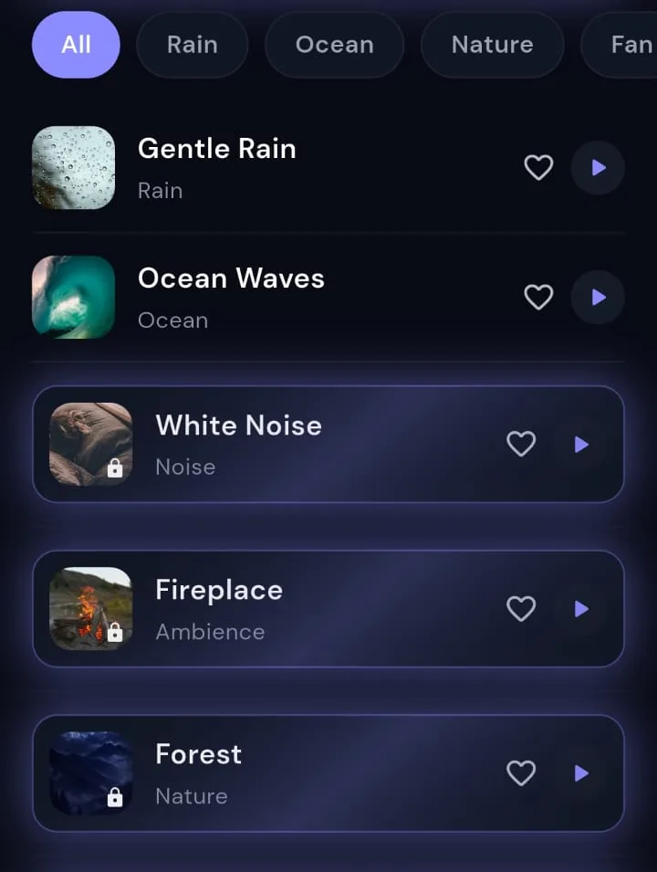
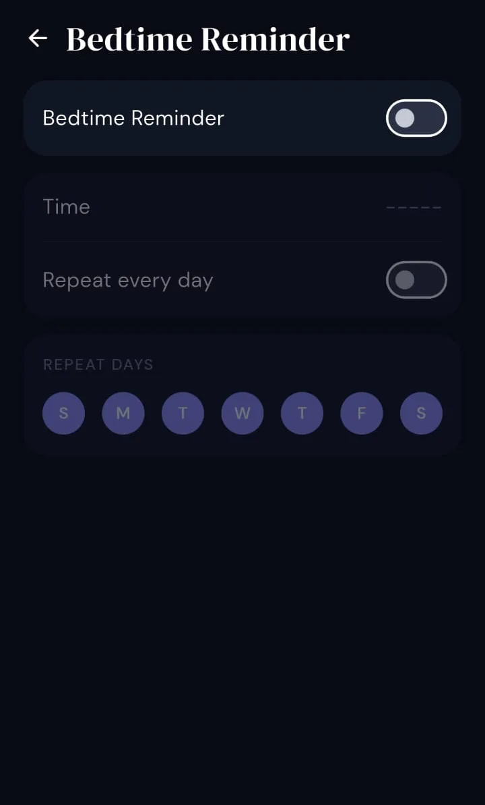
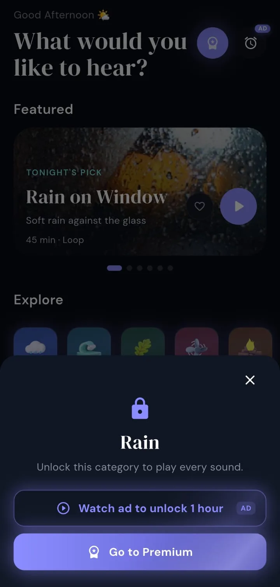
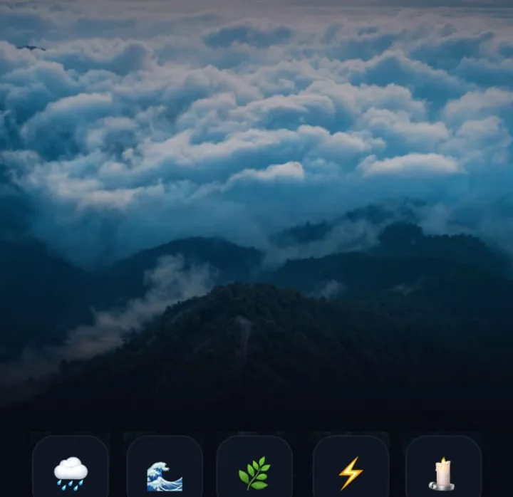
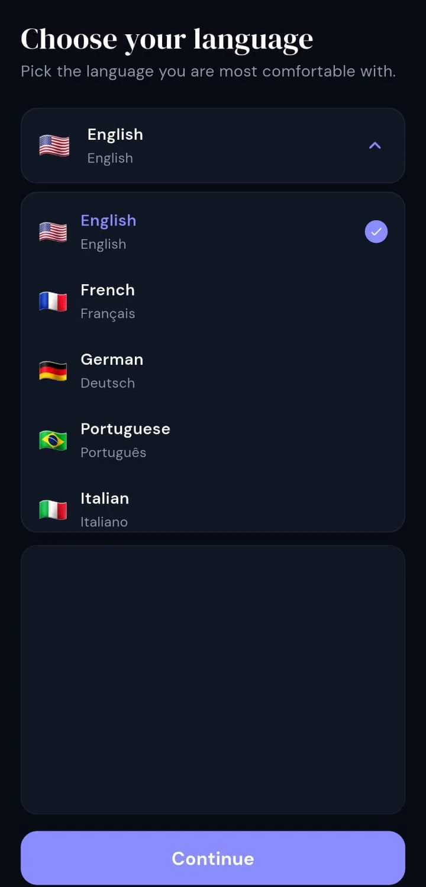
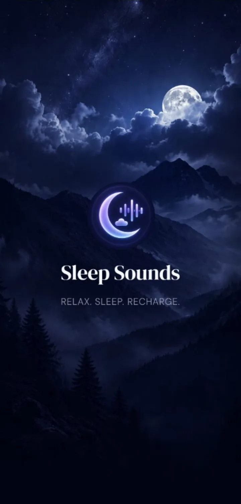
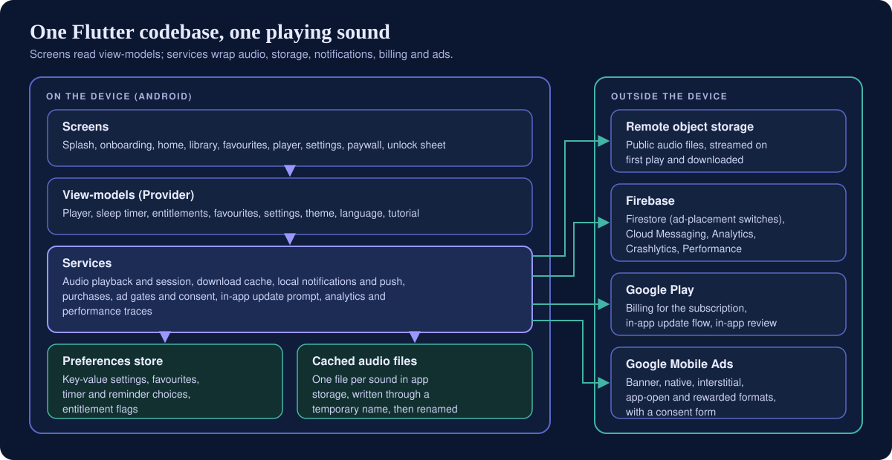
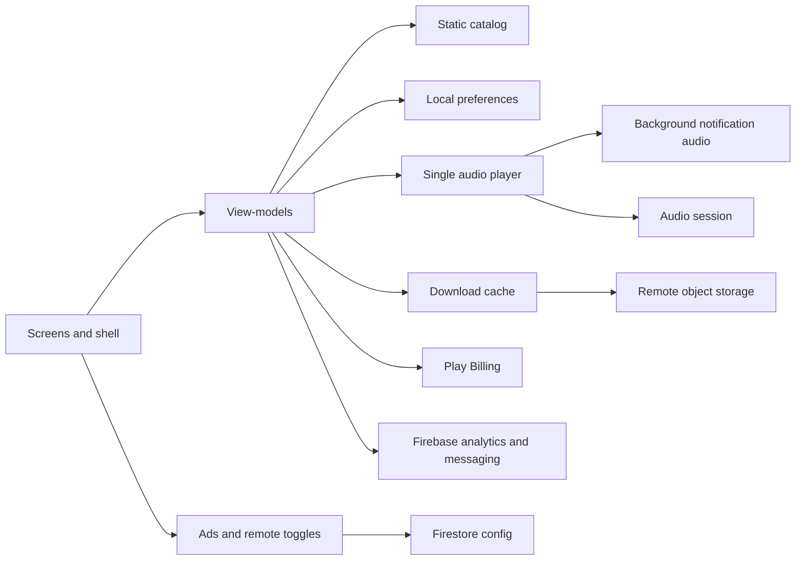

# Sleep Sounds

**An Android ambient-audio app: 24 looping sounds across six categories, played one at a time with volume control, optional loop or sleep timer with fade-out, favourites, a downloadable cache, and notification transport controls.**

**Android (Google Play)** 
Flutter · Dart · Provider · just_audio · just_audio_background · Firebase

<table>
  <tr>
    <td align="center"></td>
    <td align="center"></td>
    <td align="center"></td>
  </tr>
</table>
Real screenshots from the Android build, cropped to the app content (system status bar and ad-placeholder strips removed), captured with sample/placeholder data, metadata removed.

---

## Get the App

  

This portfolio describes the engineering of a background sound player. It does **not** claim that using the app improves sleep, reduces stress or delivers any health outcome. In-app onboarding may use sleep-oriented marketing copy; that copy is not repeated here as fact.

**Playback is single-stream:** the user hears one catalog sound at a time. There is no shipped UI to layer multiple sounds together.

## Platforms

The released app is **Android only** on Google Play (minimum SDK 26). The Flutter tree includes iOS-oriented configuration, but there is no App Store listing in the release settings and this repository does not claim an iOS launch.

## Product at a Glance

| | |
|---|---|
| **What it is** | A catalog of looping ambient recordings (rain, ocean, nature, fans, room ambience, coloured noise) with browse, favourites and a full-screen player |
| **Catalog** | 24 sounds in 6 categories (counted from the static catalog definition) |
| **Playback** | One stream at a time; loop mode or auto-advance to the next entitled sound when a clip ends without loop |
| **Sleep timer** | Presets on the player (up to 2 hours); optional default timer in settings; countdown pauses when playback pauses; optional 60-second volume fade before stop |
| **Offline** | After a sound is cached to app storage it replays without a connection; first play of an uncached sound needs network unless already on disk |
| **Access** | Free samples, category or sound locks, premium-only tracks, temporary rewarded-ad unlocks, subscription, and legacy one-time purchases still honoured on restore |
| **Background** | Music-category audio session, interruption handling, media notification via background-audio integration |
| **Extras** | Bedtime reminder notifications, 13 languages, dark theme, coach-mark tour, Play in-app updates, cross-promotion tiles |
| **Services** | Firebase (Analytics, Crashlytics, Performance, Cloud Messaging, Firestore ad toggles), Google Play Billing, Google Mobile Ads with consent |
| **Code size** | 101 Dart files and about 18.3k lines under the app library tree excluding bundled language tables (about 4.2k lines), plus 3 test files |

## Showcase

<table>
  <tr>
    <td align="center"> <b>Settings</b> Default timer, fade-out, bedtime reminder, language, theme</td>
    <td align="center"> <b>Unlock sheet</b> Rewarded ad or premium path for locked content</td>
    <td align="center"> <b>Bedtime reminder</b> Weekly schedule for a local notification</td>
    <td align="center"> <b>Language</b> Thirteen bundled locales</td>
  </tr>
  <tr>
    <td align="center"> <b>Splash</b> Launch branding</td>
    <td colspan="3"></td>
  </tr>
</table>

## Key Features

- **Home hub.** Time-of-day greeting, featured carousel, horizontal explore categories, popular list and a mini player above the tab bar.
- **Library tab.** Filter chips (all, rain, ocean, nature, fan, ambience, noise), sound rows with play and favourite actions, unlock chips while rewarded access is active.
- **Favourites.** Device-local saved list with the same play affordances.
- **Full player.** Category artwork backdrop, play or pause, skip previous and next within entitled catalog order, loop toggle, volume sheet, sleep timer sheet, favourite toggle.
- **Cache-first audio.** Local file when downloaded; otherwise HTTPS stream with parallel background download and length-checked writes.
- **Entitlements.** Subscription removes ads and unlocks all sounds; legacy store flags still apply; rewarded ads grant time-limited keys per category or sound.
- **Ads with remote kill switch.** Placements stay off until a cloud document fetch succeeds and each flag is explicitly true; premium turns all formats off.
- **Reminders and push.** Optional bedtime local notification; FCM topic subscription for promotional pushes when permission is granted.

## Engineering Highlights

### Play requests that survive slow networks
- **Problem:** switching sounds quickly leaves older `setAudioSource` calls finishing out of order and starting the wrong track.
- **Approach:** a monotonic play id invalidates stale async work; connectivity and entitlement checks run before loading; a shared play helper deduplicates taps from lists, cards and reminders.
- **Outcome:** only the latest user selection wins; offline-without-cache fails with a clear message instead of spinning forever.

### Loop, timer and clip end
- **Problem:** users want either repeat, timed stop or continuous ambience, but media files have finite length.
- **Approach:** engine loop mode pairs with a mutually exclusive sleep timer; when loop is off, completion triggers skip to the next entitled sound; timer tickers pause with playback; optional linear fade shaves volume over the last minute of timer.
- **Outcome:** timer expiry stops audio; loop keeps one file repeating; non-loop sessions can chain through the catalog without manual skips.

### Tiered catalog without a backend
- **Problem:** mix free samples, locked categories, premium-only tracks, subscription and expiring ad unlocks without a server entitlement API.
- **Approach:** rules live in catalog metadata plus persisted expiry timestamps and store callbacks; UI shows countdown while ad access remains.
- **Outcome:** locked content never starts playback; restore reloads purchase flags client-side (server validation would be a natural hardening step).

More detail: [docs/ENGINEERING_CHALLENGES.md](docs/ENGINEERING_CHALLENGES.md).

## Architecture

  

Audio flow: [assets/diagrams/audio-pipeline.svg](assets/diagrams/audio-pipeline.svg). Narrative: [docs/ARCHITECTURE.md](docs/ARCHITECTURE.md).

## Technology Stack

| Layer | Technology |
|---|---|
| App | Flutter / Dart 3, `provider`, bundled translations (13 languages) |
| Playback | `just_audio`, `just_audio_background`, `audio_session` |
| UI feedback clicks | Separate short-form player (does not share the ambient stream) |
| Storage | `shared_preferences`, app documents directory for cached MP3s |
| Network | `connectivity_plus`, `HttpClient` downloads with temp files |
| Backend | Firebase: Analytics, Crashlytics, Performance, Messaging, Firestore (ad flags) |
| Ads | Google Mobile Ads SDK, consent form integration |
| Billing | `in_app_purchase` with Android subscription base plans |
| Notifications | `flutter_local_notifications`, timezone scheduling |
| Extras | Play in-app update API, in-app review, share and URL launcher |
| Testing | `flutter_test`: three files (widget smoke, download helper, languages) |

## Documentation

| Read | For |
|---|---|
| [Technical case study](docs/TECHNICAL_CASE_STUDY.md) | End-to-end playback, cache, timer and platform behaviour |
| [Architecture](docs/ARCHITECTURE.md) | Layers, flows and diagrams |
| [Engineering challenges](docs/ENGINEERING_CHALLENGES.md) | Problem, context, approach, trade-offs, outcome |
| [Product overview](docs/PRODUCT_OVERVIEW.md) | Screens, catalog tiers and feature list |
| [Privacy and source](docs/PRIVACY_AND_SOURCE.md) | What is and is not published |

## Source Code

This repository is a portfolio showcase for a production application. Production source code is maintained privately. See [RIGHTS.md](RIGHTS.md) for usage terms.
