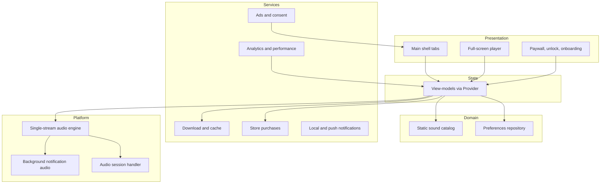
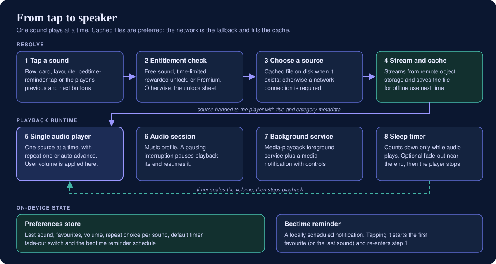
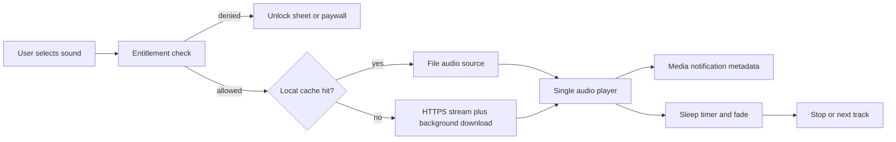
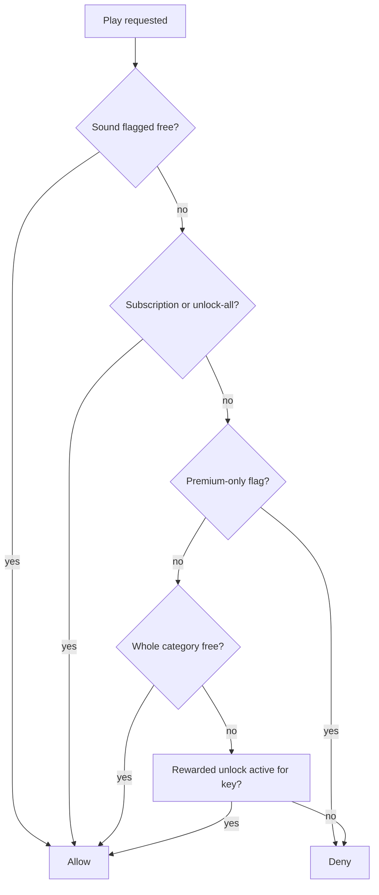
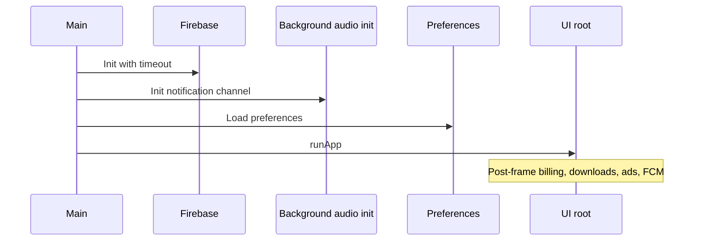

# Architecture

Diagrams in this document are original and conceptual. Labels describe responsibilities, not production class names, routes or remote document identifiers.

## 1. System overview

  

The mobile client holds the entire sound catalog in code. Audio bytes live in remote object storage; the device keeps a optional cache directory. Firebase supplies analytics, crash reporting, performance traces, push delivery and live ad toggles. Google Play Billing validates subscription and legacy purchases on device.

## 2. Client layers

Screens remain mostly stateless widgets; view-models encapsulate playback, timer, entitlements and settings mutations.

## 3. Audio pipeline

  

Only one branch feeds the engine at a time; there is no graph node that sums multiple streams.

## 4. Navigation and playback coordination

A shared helper centralises “play sound” and “open player route” so list tiles, cards and reminders do not duplicate gating logic. It:

- Shows the unlock sheet when `canPlay` is false.
- Shows a no-network dialog when streaming is required and connectivity is absent.
- Debounces concurrent play taps and prevents double-stacking the player route.

The player view-model exposes route attach/detach counters so analytics know when the full-screen player is visible.

## 5. Data on device

| Data | Storage | Notes |
|---|---|---|
| Favourites, last sound, volume, loop per sound, timer defaults, fade flag | Key-value preferences | Cleared partially via settings |
| Ad unlock expiries, purchase flags | Key-value preferences | Restored on launch |
| Mixer volume map | Key-value preferences | Written by an unused mixer state holder; not read by playback |
| Cached audio files | App documents tree | Mirrored relative paths from catalog mapping |
| Locale choice | Key-value preferences | Drives bundled translations |

No cloud database stores user playlists; Firestore reads are limited to operational config for ads.

## 6. Entitlement decision flow

Denied paths route to monetisation UI without starting the engine.

## 7. Ads architecture

Placement widgets (banner regions, interstitial gates, rewarded gates, app-open manager, native slots) ask a central manager whether their placement key is enabled. The manager combines:

- Premium / remove-ads entitlement (hard off).
- Remote document: global ads flag plus per-key booleans.
- Fetch confirmation flag (fail closed until first successful read).

Consent state gates initialisation order for the ads SDK in applicable regions.

## 8. Startup sequence (simplified)

Firebase initialisation failure is non-fatal; the app still launches with reduced telemetry.

## 9. External dependencies (conceptual)

| Concern | Role |
|---|---|
| Remote object storage | Hosts MP3 objects referenced by catalog ids |
| Firebase Analytics / Crashlytics / Performance / Messaging | Telemetry, crashes, traces, push |
| Cloud Firestore | Live ad placement toggles |
| Google Play Billing | Subscription and legacy one-time entitlements |
| Google Mobile Ads | Banners, interstitials, rewarded, app open, native |
| Play In-App Updates | Optional update prompt |

## 10. Boundaries and extension points

Natural extensions (not implemented here) include server-side receipt validation, true multi-track mixing with multiple engine instances and a single gain bus, cross-device favourite sync, and downloadable catalog updates without app release. The current architecture optimises for a self-contained catalog, client-side gates and offline replay after cache warm-up.
